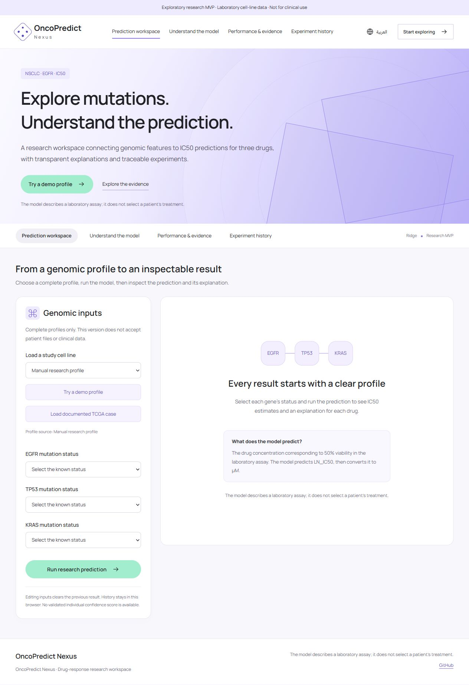
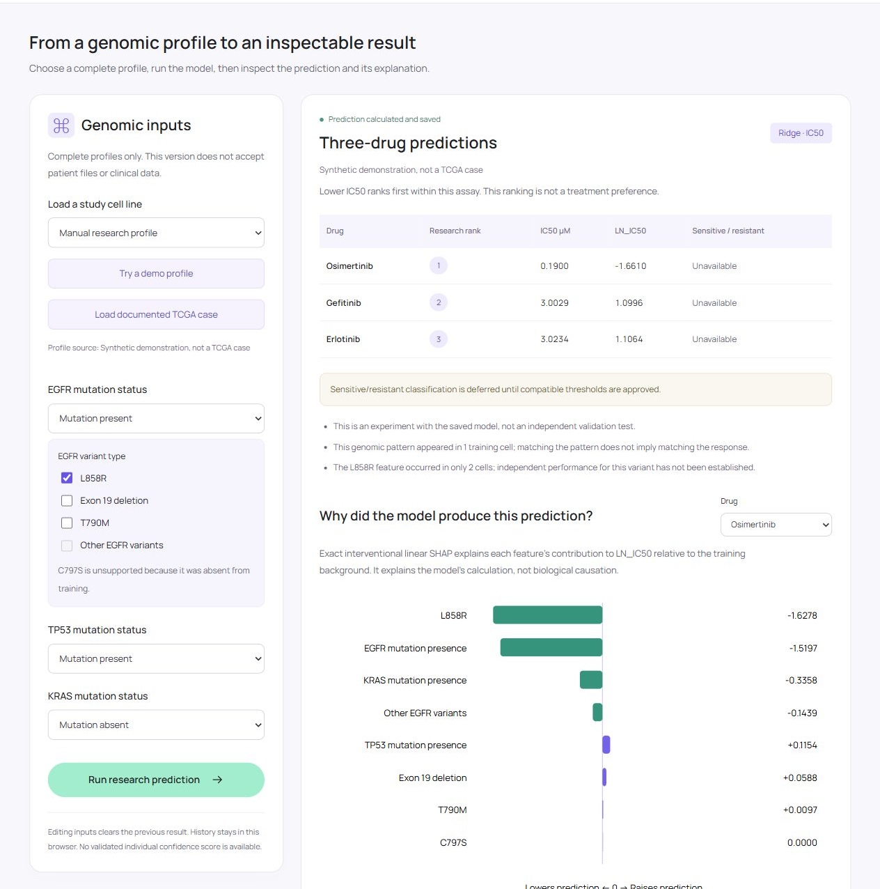
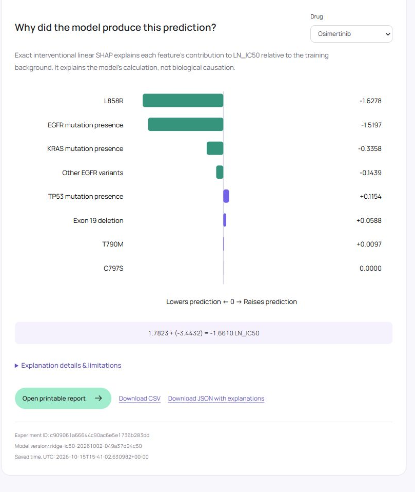

# OncoPredict Nexus

### An interpretable platform for preclinical drug-response research

[**Launch the live platform →**](https://oncopredictnexus.vercel.app) · [Screenshot gallery](docs/SCREENSHOTS.md) · [Research evidence](docs/RESEARCH.md)


OncoPredict Nexus connects supported genomic profiles to a frozen Ridge model, three-drug IC50 estimates, linear SHAP explanations, and reviewable research records. The interface supports English and Arabic, including right-to-left layout.

**Research use only.** This exploratory cell-line study does not establish clinical validity, select a patient's treatment, or provide a validated individual confidence score.



## What the platform does

- Accepts complete, supported EGFR, TP53 and KRAS mutation profiles, including supported EGFR variant flags.
- Estimates **LN_IC50** for **Osimertinib, Erlotinib and Gefitinib**, then displays `IC50 µM = exp(LN_IC50)`.
- Explains local and global computational contributions with exact interventional linear SHAP.
- Shows the frozen model version, source fingerprints, feature coverage and study limitations.
- Keeps the latest **30 experiments in the visitor's browser**, with printable reports and CSV/JSON exports.
- Includes a documented public TCGA example for provenance and workflow demonstration.



## Research evidence

The original study contains **83 independent NSCLC cell lines**, **249 cell–drug targets**, **8 binary genomic features**, and **3 drugs**. Five of 88 linked cell lines were excluded because genomic linkage was invalid. These are laboratory cell lines, not a patient cohort.

Evaluation keeps each cell line and all three drug targets together: **5 outer folds × 3 repeats**, with **4 inner folds** for tuning.

| Original model | RMSE on LN_IC50 ↓ |
| --- | ---: |
| Drug-wise mean baseline | 1.683 |
| Ridge | **1.532** |
| Random Forest | 1.561 |

Ridge's RMSE is approximately 9% lower than the baseline as a descriptive comparison. Ranking agreement was **78.7% for Ridge versus 79.5% for the baseline**. This does not establish statistical superiority, clinical benefit or a confidence score.

The executed notebook selection reached RMSE **1.516**, about **1.07%** lower than original Ridge. A bounded XGBoost comparison reached **1.578**, about **3.03% higher error**. Both conditional difference intervals included zero. Neither justified replacing the deployed model. See [research evidence](docs/RESEARCH.md).

### The main measurement limitation

**218 of 249 fitted IC50 targets (87.6%) exceed the highest tested concentration.** In 215 of these pairs, all raw-series viability points remained above 50%. Estimates outside the observed dose range constrain interpretation of numerical error. This audit does not prove that every published value is wrong.

Sensitive/resistant classification remains unavailable because compatible thresholds have not been established. C797S-positive input is unsupported because that feature had no positive training examples. Rare EGFR variant flags do not support independent subgroup performance claims.

## Explainability



Contributions explain the model's **LN_IC50 calculation relative to the training background**. Positive contributions raise the output; negative contributions lower it. All eight feature slots remain in the final calculation. Correlated EGFR flags limit interpretation of isolated contributions. SHAP does **not** establish biological causation.

## Privacy and experiment history

The public deployment computes a submitted research profile on the API server but **does not write visitor experiments to server storage or expose a shared run history**. The browser stores each result, inputs, model metadata and explanations locally. Other browsers do not receive those records.

Clearing site data removes that browser's history. Export important experiments. Local browser storage is not encrypted and is not suitable for clinical or sensitive data. Do not enter patient identifiers or upload patient files; the app does not provide a patient-file upload workflow. See [deployment and privacy behavior](docs/DEPLOYMENT.md).

## Run locally

Requirements: **Python 3.12** and **Node.js 24**. No GPU, model retraining, API key or database is required.

```bash
git clone https://github.com/blackice2090/OncoPredictNexus.git
cd OncoPredictNexus
python -m venv .venv
```

Activate the environment:

```bash
# macOS / Linux
source .venv/bin/activate

# Windows PowerShell
.venv\Scripts\Activate.ps1
```

Then install dependencies, build the interface, and start the public-demo entrypoint:

```bash
python -m pip install -r requirements.txt
npm run setup
npm run build
python -m uvicorn api.index:app --host 127.0.0.1 --port 8766
```

Open **http://127.0.0.1:8766/**. Choose **English** or **العربية**, load a demo or study profile, and run a research prediction. The frozen artifact is verified before inference.

## Deploy on Vercel

Import this repository into Vercel using its **repository root**. The checked-in configuration builds the Vite interface and packages the FastAPI ASGI entrypoint. Python dependencies retain the frozen model's library versions.

```bash
npx vercel link
npx vercel deploy
```

Validate the preview, then deploy or promote to production. Standard Vercel hostnames are detected from Vercel environment variables. For a custom domain, set `ONCOPREDICT_ALLOWED_HOSTS` to its hostname. No storage token is required for browser-private history. Details: [DEPLOYMENT.md](docs/DEPLOYMENT.md).

## Verify the release

```bash
python -m unittest discover -s app/research_predictor/tests -t . -v
npm test
npm run build
```

The tests cover frozen model parity, strict profile validation, SHAP additivity and the coalition definition, source-integrity failures, provenance checks, private-history isolation, and scientific values in exports. Passing software tests does not validate the biological predictions.

## Repository layout

```text
api/index.py                       Vercel/public ASGI entrypoint
app/research_predictor/
  engine.py                        Frozen Ridge inference and linear SHAP
  api.py                           API and optional local-file development mode
  assets/                          Verified frozen runtime snapshots
  frontend/src/                    React interface and private browser records
  frontend/public/fonts/           Locally served fonts and their licenses
  tests/                           Inference, API and privacy contracts
docs/                              Model scope, deployment, evidence and screenshots
training/ic50_notebook/             Development EDA and training notebook
training/xgboost_comparison/        Bounded algorithm comparison notebook
```

The research notebooks are separate from serving. Their cached outputs were removed from the public copies; the original research artifacts remain unchanged. They are not the source of a newly deployed or improved model. Training prerequisites and provenance are described in [training notes](training/README.md).

## Model identity

- Family: **Ridge**, `alpha = 1`.
- Version: `ridge-ic50-20261002-049a37d94c50`.
- Target: `LN_IC50`.
- Frozen artifact SHA-256:

```text
049a37d94c50aca766da3ce0e103cbcf5dbbb696474a8627bea6087cd04a0acb
```

Deployment changes storage and hosting behavior, not the model coefficients or historical evaluation results.

## Sources and acknowledgments

- [Sanger / GDSC drug-sensitivity documentation](https://depmap.sanger.ac.uk/documentation/datasets/drug-sensitivity/).
- [Broad DepMap PRISM Repurposing 20Q2](https://figshare.com/articles/dataset/PRISM_Repurposing_20Q2_Dataset/20564034).
- [gCSI / ORCESTRA record](https://www.orcestra.ca/pset/10.5281/zenodo.7829857).
- [TCGA LUAD 2014 at NCI/GDC](https://gdc.cancer.gov/about-data/publications/luad_2014).
- [SHAP LinearExplainer documentation](https://shap.readthedocs.io/en/latest/generated/shap.LinearExplainer.html).

The TCGA case is a public source-tracing demonstration, with no matched drug-response measurements and no independently confirmed clinical mutation calls. Its KRAS call has only 17 reported reads. See [RESEARCH.md](docs/RESEARCH.md) and [NOTICE.md](NOTICE.md) for scope and source attribution.

No comparative novelty, patient-treatment benefit, customer adoption or commercial validation is claimed. A new prespecified independent evaluation remains necessary.
