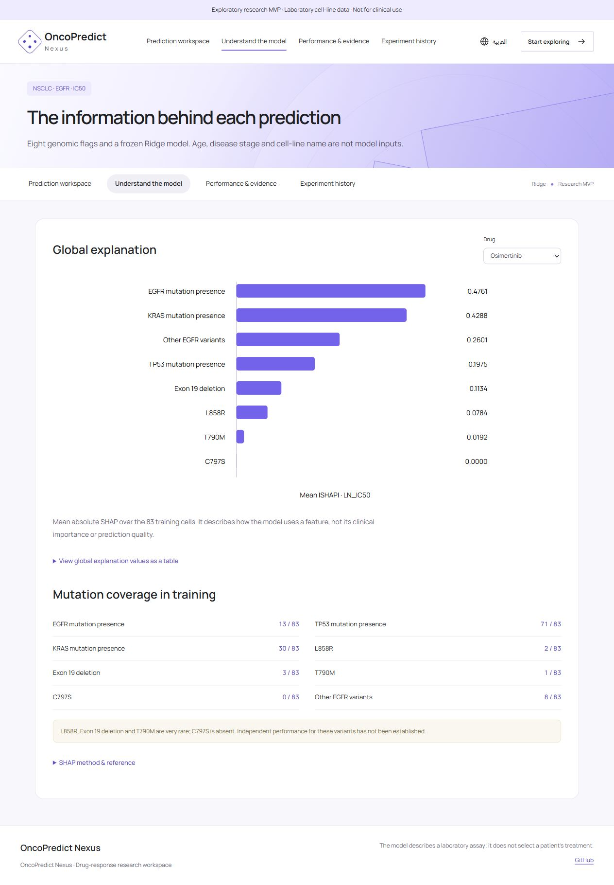
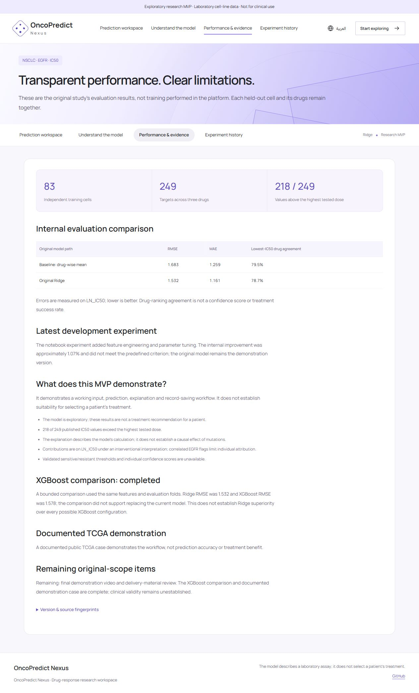
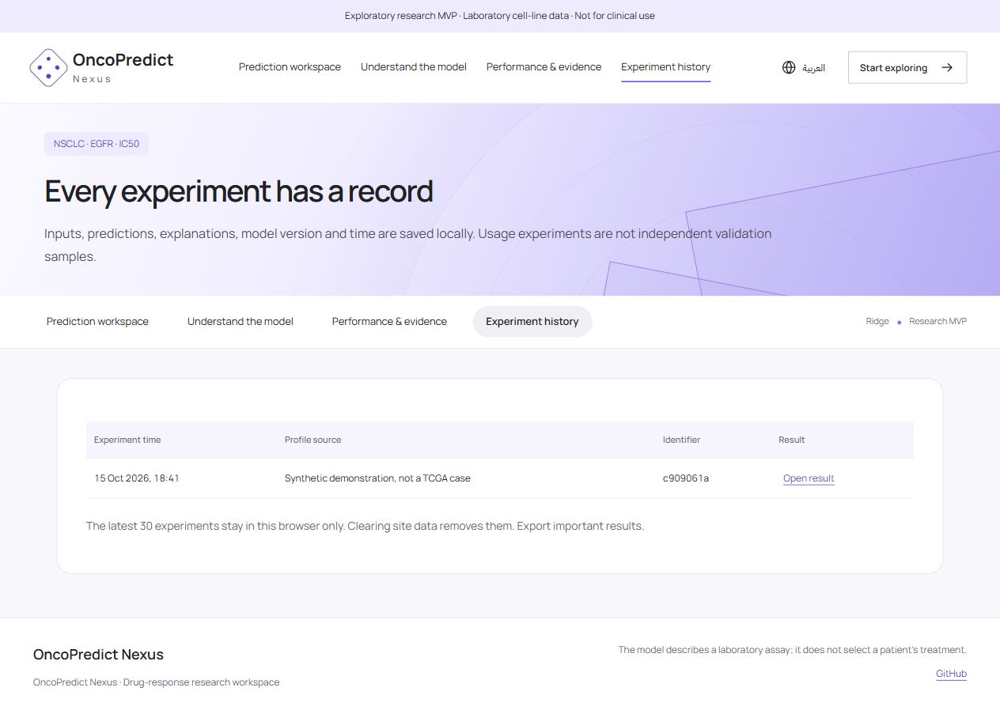

# English platform screenshots

Captured from the actual running release on 15 October 2026, with English selected. These are real application screenshots, not generated interfaces. Prediction and history examples use a synthetic demonstration profile, not patient data. The prediction and explanation detail images are rectangular crops of the original full-page capture.

## Platform overview

## Genomic inputs and three-drug predictions

[Original full-page prediction screenshot](images/prediction-full-page.png)

## Local explanation and exports

## Global explanation and mutation coverage

## Performance and evidence

## Browser-private experiment history

